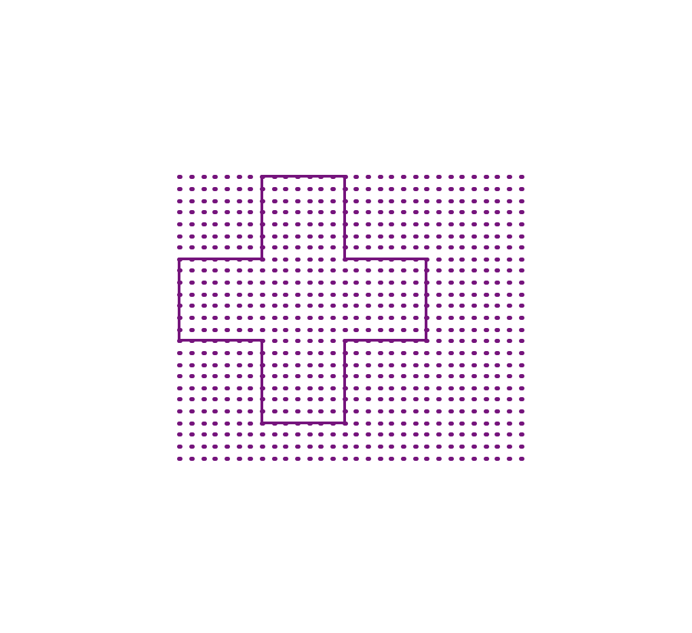

# Python Turtle Drawing

Небольшой учебный проект на Python для изучения графической библиотеки `turtle`, работы с координатами, циклами и функциями.

Программа строит геометрический рисунок из ступенчатой линии и сетки точек.

## Результат работы

<!-- После добавления скриншота в папку images -->


## Возможности

- Построение фиолетовой ступенчатой линии из четырёх повторяющихся элементов.
- Создание сетки из **750 точек** (30 столбцов × 25 строк).
- Автоматическое центрирование рисунка.
- Настройка масштаба, цвета и размеров элементов.
- Быстрая отрисовка без покадровой анимации.
- Закрытие графического окна щелчком мыши.

## Технологии

- **Python 3** — язык программирования.
- **Turtle** — стандартная графическая библиотека Python.
- **Tkinter** — графическая подсистема для отображения окна Turtle.

Сторонние библиотеки не требуются.

Разработка и проверка выполнены на macOS с использованием Python 3.14.10 и Tcl/Tk 9.0.5.

## Запуск

1. Установите Python 3 с поддержкой Tkinter.
2. Склонируйте репозиторий:

   ```bash
   git clone https://github.com/fristalli/python-turtle-drawing.git
   ```

3. Перейдите в папку проекта:

   ```bash
   cd python-turtle-drawing
   ```

4. Запустите программу:

   ```bash
   python3 main.py
   ```

   На Windows может использоваться команда `python main.py` или `py main.py`.

5. После завершения рисования щёлкните мышью в графическом окне, чтобы закрыть программу.

## Структура проекта

```text
python-turtle-drawing/
├── main.py
├── README.md
├── .gitignore
└── images/
    └── turtle-drawing.png
```

## Основные параметры

| Параметр | Назначение | Значение |
|---|---|---|
| `SCALE` | Масштаб рисунка | `9` |
| `COLOR` | Цвет линии и точек | `purple` |
| `STEPS` | Количество повторений | `4` |
| `DOT_COLUMNS` | Количество столбцов | `30` |
| `DOT_SIZE` | Размер точек | `3` |
| `WINDOW_WIDTH` | Ширина окна | `550` |
| `WINDOW_HEIGHT` | Высота окна | `500` |

## Что изучаем

- Перемещение и поворот черепашки: `forward()`, `right()`, `left()`, `setheading()`.
- Работу с координатами: `goto()`, `penup()`, `pendown()`.
- Построение точек методом `dot()`.
- Циклы `for` и функцию `range()`.
- Создание и использование функций.
- Настройку графического окна через `Screen()`.
- Автоматическое вычисление координат для центрирования изображения.

## Возможности дальнейшего развития

Проект можно расширить добавлением пользовательских настроек, других цветов, геометрических фигур и вариантов построения сетки.

---

**Тип проекта:** учебный

**Автор:** [fristalli](https://github.com/fristalli)